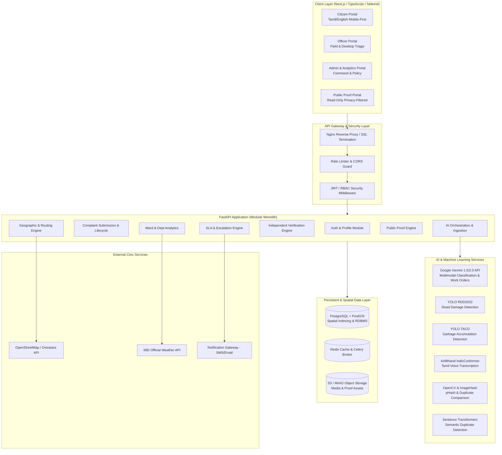
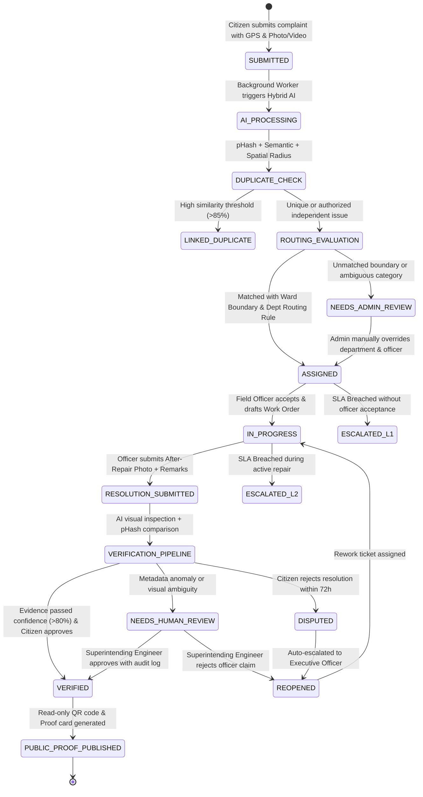
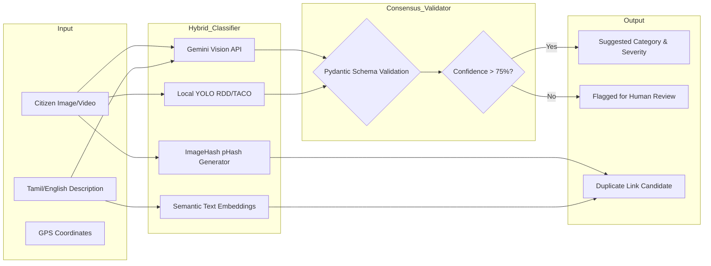
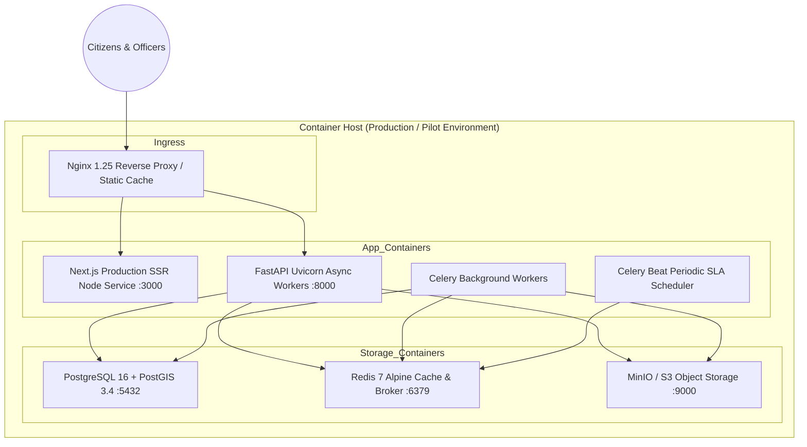

# AADHIRAI — System Architecture Specification
## AI-Powered Civic Accountability Engine

---

### 1. Architectural Philosophy & Core Tenets

AADHIRAI is engineered on six non-negotiable architectural tenets:
1. **Evidence-Driven Finality**: No grievance ticket can transition to `VERIFIED_RESOLVED` purely through bureaucratic sign-off. It requires verifiable computer-vision and human-audited proof (before/after imagery, timestamp/coordinate coherence, perceptual hash matching).
2. **Deterministic Jurisdiction Routing**: While AI assists in categorization and text interpretation, **geospatial routing is 100% deterministic, explainable, and rule-governed** using PostGIS spatial boundaries and administrative ward tables.
3. **AI as Advisor, Not Autocrat**: Machine learning models (Gemini multimodal, YOLO RDD2022, TACO) provide recommendations and confidence scores. Uncertain predictions or critical anomalies trigger human review workflows.
4. **Tamil-First Accessibility**: Equal digital parity for Tamil and English users across UI, voice transcription (IndicConformer), and notification messaging.
5. **Zero-PII Public Proof**: Public transparency must never jeopardize citizen privacy. All public proof artifacts are rigorously sanitized of names, phone numbers, exact residential coordinates, and internal remarks.
6. **Resilient Degradation**: System operation persists cleanly even if third-party APIs (Gemini, IMD weather, external SMS gateways) experience network or quota outages.

---

### 2. High-Level System Architecture

---

### 3. Detailed Data-Flow & Complaint Lifecycle

The core accountability lifecycle follows strict state transitions:

---

### 4. AI & Machine Learning Pipeline

---

### 5. Independent Evidence Verification Architecture

Verification is the differentiator of AADHIRAI:
1. **Perceptual Image Hashing (`dhash` + `phash`)**:
   - Detects whether the officer re-uploaded the original "before" image, a stock image from the web, or an image from another ward.
   - Hamming distance $< 5$ between before and after images immediately flags `FRAUD_ALERT_DUPLICATE_IMAGE`.
2. **Spatial & Temporal Coherence**:
   - Compares the EXIF/upload coordinates of the resolution photo with the complaint origin point.
   - Flags delta $> 150$ meters for manual review.
3. **Multimodal Visual Delta Analysis**:
   - Gemini Vision and OpenCV contour difference assess structural state change (e.g. pothole asphalt patch visible, garbage heap absent, illuminated street light).
4. **Citizen Confirmation Window**:
   - 72-hour citizen verification grace period. If citizen marks `DISPUTED`, status triggers escalation to higher municipal authority.

---

### 6. Deployment Architecture

