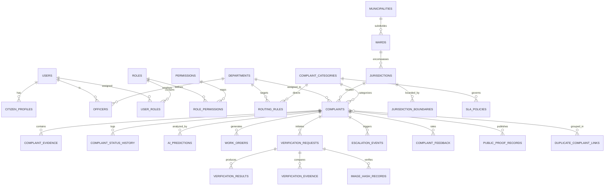

# AADHIRAI — Database Architecture & ER Design
## PostgreSQL 16 + PostGIS Spatial Relational Model

---

### 1. Architectural Guidelines for the Database

1. **UUID Primary Keys**: All core entity records use UUID v4 to ensure distributed uniqueness, security against enumeration attacks, and multi-tenant portability.
2. **PostGIS Geography**: Precise spatial locations (`Point`, `Polygon`, `MultiPolygon`) are indexed with spatial R-tree indexes (`GIST`) using SRID 4326 (WGS 84).
3. **Immutability of Audit Trails**: Status changes, officer re-assignments, escalation triggers, and verification overrides are recorded in append-only log tables.
4. **Zero Binary Storage**: Image and video evidence binaries are stored in S3/MinIO object storage; the database stores only sanitized storage keys, MIME metadata, and perceptual hashes.
5. **Soft Deletes**: Non-audit entities use `is_active` / `deleted_at` fields to preserve historical references.

---

### 2. Entity Relationship Diagram (ERD)

---

### 3. Detailed Table Schema Definitions

#### A. Identity & Access Control (RBAC)
- **`users`**:
  - `id` (UUID, PK)
  - `phone` (VARCHAR(15), UNIQUE, indexed)
  - `email` (VARCHAR(255), UNIQUE, nullable)
  - `password_hash` (VARCHAR(255), NOT NULL)
  - `full_name` (VARCHAR(150), NOT NULL)
  - `preferred_language` (VARCHAR(5), DEFAULT 'ta') -- 'ta' or 'en'
  - `is_active` (BOOLEAN, DEFAULT true)
  - `created_at`, `updated_at` (TIMESTAMPTZ)
- **`roles`**:
  - `id` (UUID, PK)
  - `name` (VARCHAR(50), UNIQUE) -- 'citizen', 'field_officer', 'department_admin', 'super_admin'
  - `description` (TEXT)
- **`permissions`**:
  - `id` (UUID, PK)
  - `code` (VARCHAR(100), UNIQUE) -- e.g. `complaints:write`, `verification:override`
- **`officers`**:
  - `id` (UUID, PK)
  - `user_id` (UUID, FK -> users.id)
  - `department_id` (UUID, FK -> departments.id)
  - `badge_number` (VARCHAR(50), UNIQUE)
  - `designation` (VARCHAR(100)) -- e.g. 'Assistant Executive Engineer - Ward 7'
  - `jurisdiction_id` (UUID, FK -> jurisdictions.id)
  - `is_on_duty` (BOOLEAN, DEFAULT true)

#### B. Administrative & Geospatial Topology
- **`districts`**:
  - `id` (UUID, PK)
  - `name_en` (VARCHAR(100)), `name_ta` (VARCHAR(100)) -- e.g. 'Tiruchirappalli' / 'திருச்சிராப்பள்ளி'
  - `state_code` (VARCHAR(10), DEFAULT 'TN')
- **`municipalities`**:
  - `id` (UUID, PK)
  - `district_id` (UUID, FK -> districts.id)
  - `name_en` (VARCHAR(100)), `name_ta` (VARCHAR(100)) -- e.g. 'Musiri' / 'முசிறி'
  - `boundary_geom` (GEOMETRY(MultiPolygon, 4326))
- **`wards`**:
  - `id` (UUID, PK)
  - `municipality_id` (UUID, FK -> municipalities.id)
  - `ward_number` (INTEGER, NOT NULL) -- 1 to 24 in Musiri
  - `name_en` (VARCHAR(100)), `name_ta` (VARCHAR(100))
  - `boundary_geom` (GEOMETRY(MultiPolygon, 4326), GIST indexed)
- **`routing_rules`**:
  - `id` (UUID, PK)
  - `category_id` (UUID, FK -> complaint_categories.id)
  - `municipality_id` (UUID, FK -> municipalities.id)
  - `target_department_id` (UUID, FK -> departments.id)
  - `priority_weight` (INTEGER, DEFAULT 1)

#### C. Complaints & Lifecycle Management
- **`complaint_categories`**:
  - `id` (UUID, PK)
  - `code` (VARCHAR(50), UNIQUE) -- 'road_damage', 'garbage_accumulation', 'broken_streetlight', 'water_leakage', etc.
  - `name_en` (VARCHAR(100)), `name_ta` (VARCHAR(100))
  - `default_priority` (VARCHAR(20)) -- 'LOW', 'MEDIUM', 'HIGH', 'CRITICAL'
  - `icon_key` (VARCHAR(50))
  - `is_active` (BOOLEAN, DEFAULT true)
- **`complaints`**:
  - `id` (UUID, PK)
  - `public_reference` (VARCHAR(30), UNIQUE, indexed) -- e.g. `ADH-2026-MSR-0084`
  - `citizen_id` (UUID, FK -> users.id)
  - `category_id` (UUID, FK -> complaint_categories.id)
  - `title` (VARCHAR(255), NOT NULL)
  - `description` (TEXT, NOT NULL)
  - `language` (VARCHAR(5), DEFAULT 'ta')
  - `priority` (VARCHAR(20), DEFAULT 'MEDIUM')
  - `status` (VARCHAR(30), NOT NULL, indexed) -- 'SUBMITTED', 'ASSIGNED', 'IN_PROGRESS', 'RESOLVED_PENDING_VERIFICATION', 'VERIFIED_RESOLVED', 'NEEDS_REVIEW', 'DISPUTED', 'REOPENED'
  - `location_geom` (GEOMETRY(Point, 4326), NOT NULL, GIST indexed)
  - `latitude` (DOUBLE PRECISION), `longitude` (DOUBLE PRECISION)
  - `address_text` (TEXT)
  - `landmark` (VARCHAR(255))
  - `ward_id` (UUID, FK -> wards.id, nullable)
  - `assigned_department_id` (UUID, FK -> departments.id, nullable)
  - `assigned_officer_id` (UUID, FK -> officers.id, nullable)
  - `ai_suggested_category` (VARCHAR(50))
  - `ai_confidence` (FLOAT)
  - `requires_human_review` (BOOLEAN, DEFAULT false)
  - `due_at` (TIMESTAMPTZ, indexed)
  - `resolved_at` (TIMESTAMPTZ)
  - `created_at`, `updated_at` (TIMESTAMPTZ, NOT NULL)
- **`complaint_evidence`**:
  - `id` (UUID, PK)
  - `complaint_id` (UUID, FK -> complaints.id)
  - `evidence_phase` (VARCHAR(20), NOT NULL) -- 'INITIAL_SUBMISSION', 'WORK_ORDER', 'RESOLUTION_PROOF'
  - `media_type` (VARCHAR(20)) -- 'IMAGE', 'VIDEO', 'AUDIO'
  - `storage_key` (VARCHAR(500), NOT NULL)
  - `mime_type` (VARCHAR(100), NOT NULL)
  - `file_size_bytes` (BIGINT)
  - `perceptual_hash` (VARCHAR(64), indexed)
  - `exif_latitude` (DOUBLE PRECISION), `exif_longitude` (DOUBLE PRECISION)
  - `exif_timestamp` (TIMESTAMPTZ)
  - `uploaded_by` (UUID, FK -> users.id)
  - `uploaded_at` (TIMESTAMPTZ)

#### D. AI & Verification Tables
- **`ai_predictions`**:
  - `id` (UUID, PK)
  - `complaint_id` (UUID, FK -> complaints.id)
  - `model_name` (VARCHAR(100)) -- 'gemini-1.5-pro', 'yolo-rdd2022-v1', 'indic-conformer-ta'
  - `model_version` (VARCHAR(50))
  - `raw_response` (JSONB)
  - `suggested_category` (VARCHAR(50))
  - `detected_objects` (JSONB)
  - `confidence_score` (FLOAT)
  - `reasoning_notes` (TEXT)
  - `human_overridden` (BOOLEAN, DEFAULT false)
  - `created_at` (TIMESTAMPTZ)
- **`verification_requests`**:
  - `id` (UUID, PK)
  - `complaint_id` (UUID, FK -> complaints.id)
  - `submitted_by_officer_id` (UUID, FK -> officers.id)
  - `status` (VARCHAR(30)) -- 'PENDING', 'PASSED', 'FLAGGED_REVIEW', 'OVERRIDDEN', 'REJECTED'
  - `ai_visual_delta_score` (FLOAT) -- 0.0 to 1.0 similarity/restoration score
  - `phash_match_detected` (BOOLEAN, DEFAULT false) -- true if before/after are identical (fraud)
  - `gps_distance_delta_meters` (FLOAT)
  - `reviewer_notes` (TEXT)
  - `reviewed_by` (UUID, FK -> users.id, nullable)
  - `reviewed_at` (TIMESTAMPTZ)
- **`public_proof_records`**:
  - `id` (UUID, PK)
  - `complaint_id` (UUID, FK -> complaints.id, UNIQUE)
  - `public_reference` (VARCHAR(30), UNIQUE, indexed)
  - `anonymized_ward` (VARCHAR(100))
  - `approximate_latitude` (DOUBLE PRECISION) -- truncated to 3 decimals (~110m)
  - `approximate_longitude` (DOUBLE PRECISION)
  - `before_evidence_url` (TEXT)
  - `after_evidence_url` (TEXT)
  - `verification_summary` (TEXT)
  - `qr_code_storage_key` (TEXT)
  - `published_at` (TIMESTAMPTZ)

#### E. SLA & Escalation Engine
- **`sla_policies`**:
  - `id` (UUID, PK)
  - `category_id` (UUID, FK -> complaint_categories.id)
  - `priority` (VARCHAR(20))
  - `max_resolution_hours` (INTEGER) -- e.g. 24h for water burst, 48h for streetlight, 120h for road patch
  - `warning_threshold_hours` (INTEGER)
- **`escalation_events`**:
  - `id` (UUID, PK)
  - `complaint_id` (UUID, FK -> complaints.id)
  - `level` (INTEGER) -- 1: Ward Supervisor, 2: Municipal Engineer, 3: Municipal Commissioner / Collector
  - `trigger_reason` (VARCHAR(100)) -- 'SLA_BREACH_ACCEPTANCE', 'SLA_BREACH_RESOLUTION', 'CITIZEN_DISPUTE'
  - `escalated_to_user_id` (UUID, FK -> users.id)
  - `notification_sent` (BOOLEAN, DEFAULT false)
  - `created_at` (TIMESTAMPTZ)
